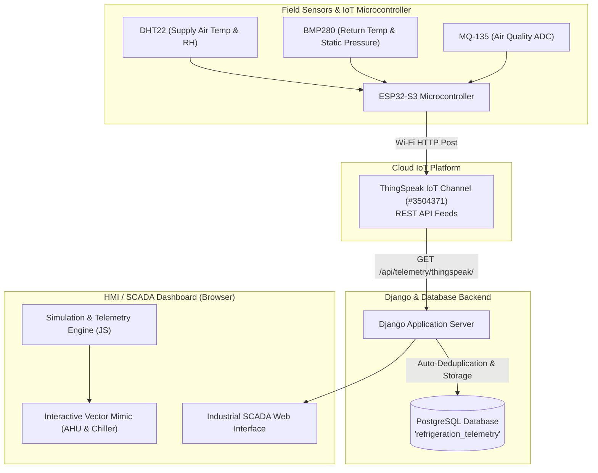

# Smart HVAC-R Digital Twin: Air Handling Unit (AHU) & Refrigeration SCADA Monitor

An industrial-grade Building Management System (BMS) and SCADA Digital Twin combining an **Air Handling Unit (AHU)** air-side workflow with a **Vapour-Compression Refrigeration Cycle**.

The system operates in two synchronized modes:
1. **Simulation Mode (`/`)**: An interactive thermodynamic simulator allowing operators to adjust VFD fan speeds, cooling/heating valves, damper positions, and airflow setpoints with real-time thermodynamic response.
2. **Live IoT Mode (`/ahu/live/` & `/refrigeration/live/`)**: A real-time hardware telemetry dashboard fetching live physical sensor data from an **ESP32-S3** microcontroller via **ThingSpeak**, logging time-series records to **PostgreSQL**, and driving the SVG process animations directly from live environment readings.

---

## System Architecture



---

## Key Features

### 1. Dual Operational Modes
* **Simulation Mode**:
  * Operator manual control sliders for Cooling Valve (0–100%), Heating Valve (0–100%), Supply Damper (0–100%), VAV Damper (0–100%), and VFD Fan Speed (0–60 Hz).
  * Real-time thermal mixing, coil temperature drops, filter pressure differential ($DP \propto \text{CFM}^2$), and duct static pressure calculations.
* **Live IoT Telemetry Mode**:
  * Direct read-only monitoring interface with manual sliders automatically hidden.
  * Real-time polling (every 3 seconds) from ThingSpeak cloud feeds.
  * Live status banner showing channel entry ID, ESP32 timestamp, and connection health.
  * Automatic sensor disconnect detection (alerts when wire leads or sensors lose power/signal).

### 2. Animated SCADA / BMS Process Mimic
* Pure vector SVG schematic of an industrial Air Handling Unit:
  * **Mixing Chamber**: Fresh Outdoor Air (OA) and Return Air (RA) with motorized VAV dampers.
  * **Pre-Filter Stage**: Dynamic differential pressure readout and alarm states.
  * **Chilled Water Cooling Coil**: Animated cooling water piping flow, stem lift, and fin frost-glow gradients.
  * **Hot Water Heating Coil**: Thermal heating glow and dynamic heating water circulation.
  * **Centrifugal Supply Fan**: Continuous rotational speed animation tied to VFD frequency.
  * **Supply Filter & Damper**: Final filtration stage and motorized volume damper control.
  * **Color-Coded Thermodynamic Readout Cards**: Real-time stage temperatures, relative humidity, CFM airflow, and static pressure.

### 3. Vapour-Compression Refrigeration Cycle
* 4-component physical refrigeration loop:
  1. **Hermetic Compressor** (Suction & Discharge Pressures/Temperatures, Motor Current, RPM)
  2. **Air-Cooled Condenser** (Condenser Outlet Subcooling Temp)
  3. **Expansion Device / Capillary Tube** (Pressure drop and flash-gas expansion)
  4. **Direct Expansion (DX) Evaporator** (Inlet/Outlet Temperatures and Superheat calculation)
* Animated fluid particle stream showing state changes (high-pressure gas $\rightarrow$ high-pressure liquid $\rightarrow$ low-pressure flashing mixture $\rightarrow$ superheated vapour).

### 4. PostgreSQL Telemetry Logging
* Every incoming IoT record is automatically saved to PostgreSQL (`refrigeration_telemetry` table).
* Built-in deduplication prevents redundant entries when the microcontroller uploads at a slower rate.
* Telemetry API supports query by date/time range for historical analysis and chart playback.

---

## IoT Hardware & Sensor Mapping

The current deployment connects to ThingSpeak Channel **`#3504371`** (Read Key: `SNKTWBRJ0LSJIK2I`):

| Channel Field | Hardware Sensor | Engineering Parameter | Unit | UI Card Name |
| :--- | :--- | :--- | :--- | :--- |
| **Field 1** | DHT22 | Supply Air Temperature | °C | `SUPPLY AIR TEMP.` |
| **Field 2** | DHT22 | Relative Humidity | % | `RELATIVE HUMIDITY` |
| **Field 3** | BMP280 | Return Air Temperature | °C | `RETURN AIR TEMP.` |
| **Field 4** | BMP280 | Supply Static Pressure | hPa / Pa | `SUPPLY STATIC PRESSURE` |
| **Field 5** | BMP280 | Barometric Altitude / Aux | m | Internal Auxiliary |
| **Field 6** | MQ-135 | Air Quality VOC ADC | ADC / ppm | Air Quality Index |

---

## Project Structure

```
AC-Simulation-main/
├── manage.py                          # Django management script
├── requirements.txt                   # Python dependencies
├── project/                           # Project configuration
│   ├── settings.py                    # Database, apps, static configuration
│   ├── urls.py                        # Root URL routing
│   ├── wsgi.py                        # WSGI server entry point
│   └── asgi.py                        # ASGI asynchronous entry point
└── refrigerator/                      # Core HVAC-R Django Application
    ├── models.py                      # PostgreSQL RefrigerationTelemetry model
    ├── views.py                       # HTTP views & ThingSpeak polling endpoints
    ├── urls.py                        # Application route definitions
    ├── templates/refrigerator/
    │   └── index.html                 # BMS HMI template with embedded SVG mimic
    └── static/refrigerator/
        ├── css/
        │   └── style.css              # Industrial SCADA/HMI theme & responsive grid
        └── js/
            ├── app.js                 # ThingSpeak polling engine & event controller
            ├── ui.js                  # SVG mimic animation, DOM rendering, alert logic
            ├── simulation.js          # Thermodynamic simulation model
            └── history.js             # Historical telemetry queries & playback
```

---

## API Endpoints

| Endpoint | Method | Description |
| :--- | :--- | :--- |
| `/` | `GET` | Main AHU Simulation & Control Dashboard |
| `/ahu/live/` | `GET` | Dedicated Live AHU IoT Mode (Manual controls hidden) |
| `/refrigeration/` | `GET` | Refrigeration Cycle Simulation Monitor |
| `/refrigeration/live/` | `GET` | Live Refrigeration Telemetry View |
| `/api/telemetry/thingspeak/` | `GET` | Polls ThingSpeak, logs record to PostgreSQL, and returns JSON payload |
| `/api/telemetry/save/` | `POST` | Manually logs current machine state to database |
| `/api/telemetry/history/` | `GET` | Retrieves historical telemetry records within a timestamp range |
| `/api/telemetry/range-info/` | `GET` | Returns first and last timestamp recorded in PostgreSQL |

---

## Setup & Running Instructions

### Prerequisites
* Python 3.10+
* PostgreSQL server running locally or accessible via network

### 1. Installation
Clone the repository and install the required dependencies:
```powershell
# Navigate into project directory
cd "AC-Simulation-main"

# Activate your virtual environment (if present)
.\venv\Scripts\activate

# Install dependencies
pip install -r requirements.txt
```

### 2. Database Configuration
Ensure your PostgreSQL database credentials in `project/settings.py` match your local database:
```python
DATABASES = {
    'default': {
        'ENGINE': 'django.db.backends.postgresql',
        'NAME': 'AC SIMULATIOM',      # Database name
        'USER': 'postgres',
        'PASSWORD': 'your_password',
        'HOST': 'localhost',
        'PORT': '5432',
    }
}
```

Apply migrations:
```powershell
python manage.py migrate
```

### 3. Launch Development Server
```powershell
python manage.py runserver
```

Open your browser:
* **Interactive Simulation**: [http://127.0.0.1:8000/](http://127.0.0.1:8000/)
* **Live IoT Stream**: [http://127.0.0.1:8000/ahu/live/](http://127.0.0.1:8000/ahu/live/)

---

## License & Author
* **Project**: AC Simulation AHU Clean Workflow
* **Operator**: MADHUMANOJ
* **Purpose**: IoT-based Environmental Monitoring and Real-Time HVAC-R SCADA Digital Twin
